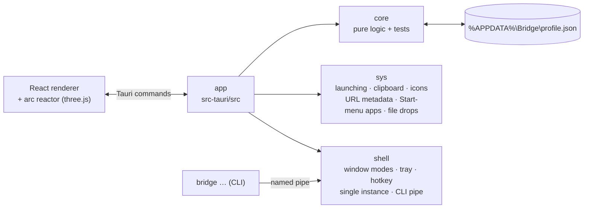
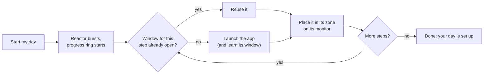

<p align="center">
  <a href="https://coreylallojr.github.io/bridge/"></a>
</p>

<p align="center">
  <a href="https://coreylallojr.github.io/bridge/"></a>
  
  
  
  
  <a href="LICENSE.md"></a>
</p>

<p align="center">
  <b><a href="https://coreylallojr.github.io/bridge/">Website</a></b> ·
  <a href="#build">Build</a> ·
  <a href="#what-it-does">What it does</a> ·
  <a href="#how-it-works">How it works</a> ·
  <a href="#your-data">Your data</a> ·
  <a href="#license-and-credit">License</a>
</p>

<h3 align="center">A local, full-screen command center for Windows.<br>One click to everything, your monitors arranged, and an arc reactor keeping time.</h3>

<p align="center"></p>
<p align="center"><sub>An illustration of the main screen. To see the real reactor running live in your browser, visit the <a href="https://coreylallojr.github.io/bridge/">website</a>.</sub></p>

|   |   |
|---|---|
| **Tiles.** One-click links, apps, folders and scripts, grouped and searchable from a command palette. | **Start my day.** A routine opens your apps and places their windows on your monitors, using zones and workspaces. |
| **Arc reactor.** An animated centerpiece with the clock at its core. Calm motion gives a still glow. | **Shell.** A global hotkey (default `Alt+Space`), tray icon, single instance, and a `bridge …` CLI over a named pipe. |
| **Widgets and themes.** Routine, recent and PC-stats widgets; themes, density, font scale, motion and quality controls. | **Local only.** No cloud services and no telemetry. Fonts and Three.js are bundled, and your profile stays on your PC. |

## Build

Requirements: Windows 10/11 with WebView2, Node 20+, and Rust (stable). `scripts/rust.mjs` adds `~/.cargo/bin` and
`%LOCALAPPDATA%\Programs\winlibs\mingw64\bin` to PATH. That's for the GNU toolchain; the MSVC toolchain works too.

```sh
git clone https://github.com/coreylallojr/bridge && cd bridge
npm install
npm run tauri:build   # vite build + release exe (the first build is slow)
npm start             # run it
```

Press **`Alt+Space`** anywhere to bring Bridge up, then just start typing to search your tiles.

## What it does

<details open>
<summary><b>Tiles and the command palette</b></summary>

Tiles open links, apps (including Start-menu apps), folders and scripts with one click. Group them in the rail on the
left, drop files or links onto Bridge to add them, and start typing to search everything. Bridge fetches titles for links
and reads icons from Windows.

</details>

<details open>
<summary><b>Start my day, zones and workspaces</b></summary>

A routine is a list of steps. **Start my day** runs yours: each step opens a tile, or moves an app that's already open, and
puts its window in a zone on one of your monitors. On the first run Bridge learns which window belongs to each step; later
runs reuse an open window instead of opening another one. The Workspaces screen draws your real monitors to scale, and
**Use my current windows** captures a workspace from what's on screen right now.

</details>

<details>
<summary><b>The arc reactor</b></summary>

The reactor is a Three.js scene: a neural lattice of 152 nodes, signals travelling along its edges, six tilted rings and
bloom, rendered on pure black with the theme's sea color blended on top. It reacts to what you do:

- it grows in when Bridge starts;
- it bursts when Start my day runs, and a progress ring fills as each step finishes;
- signals fire along the lattice when you open a tile;
- it flashes red when a launch fails.

It draws at most 30 fps while Bridge is focused, 12 fps when it isn't, and nothing while hidden. **Calm motion** (or the
OS reduced-motion setting) turns it into a still glow.

</details>

<details>
<summary><b>Themes, widgets and settings</b></summary>

- **Themes:** Command (deep sea, cyan and amber), Ember (warm amber), Mono (quiet greys) and High contrast. An accent color
  re-tints the reactor too.
- **Widgets:** your routine, recent launches, and PC stats.
- **Settings:** hotkey, window mode, density, font scale, glass, frame rate, render quality and calm motion.

</details>

<details>
<summary><b>Shell and CLI</b></summary>

Bridge runs as a single instance with a tray icon and a global hotkey. Running `bridge …` again from a terminal hands its
arguments to the running instance over a named pipe (a round trip takes about 1.4 ms), so scripts can drive it.

</details>

## How it works





| Path | What |
|---|---|
| `src/renderer/` | React UI, the reactor (`reactor/Reactor.ts`) and themes (`theme.ts`) |
| `src-tauri/core` | pure logic + tests |
| `src-tauri/sys` | launching, clipboard, icons, URL metadata, Start-menu apps, file drops |
| `src-tauri/shell` | window modes, tray, hotkey, single instance, CLI pipe |
| `src-tauri/src` | app wiring and API |
| `site/` | the [website](https://coreylallojr.github.io/bridge/); it imports the app's own reactor and themes |

## Your data

Your profile lives in `%APPDATA%\Bridge\profile.json`, never in the repo. On first run Bridge seeds it from
[examples/starter-profile.json](examples/starter-profile.json). Edit tiles in the app or in that file.

There are no accounts, no cloud services and no telemetry.

## Performance

Moving from Electron to Tauri 2 + Rust (numbers from [docs/perf-baseline.md](docs/perf-baseline.md), measured on the
author's PC):

| | Electron | Tauri 2 + Rust |
|---|---|---|
| Size on disk | 361 MB | **7.5 MB** |
| Cold start to window | 5.9 s | **2.4 s** |
| CPU while visible (share of one core) | 180% | **60%**, after the reactor's frame cap and render budget |
| `bridge` pipe round trip | 7 ms | **1.4 ms** |

## Tests

```sh
npm test              # renderer unit tests (Vitest)
npm run rust:test     # Rust workspace tests
npm run typecheck
```

To work on the website, run `npx vite --config site/vite.config.ts` (dev server) or
`npx vite build --config site/vite.config.ts` (output in `site/dist`). It deploys from `main` through
[`.github/workflows/pages.yml`](.github/workflows/pages.yml).

## License and credit

Bridge is © 2026 Corey Lallo and is **source-available** under the
[PolyForm Noncommercial License 1.0.0](LICENSE.md):

- **Allowed:** using, studying, modifying and sharing it for personal, hobby, research, educational or other
  noncommercial purposes.
- **Required:** keep the [NOTICE](NOTICE) file and its `Required Notice:` line, and credit the original author
  ("Bridge by Corey Lallo, github.com/coreylallojr/bridge") in any copy or fork.
- **Not allowed without written permission:** selling it, bundling it in a commercial product, or using it for
  commercial work.

For commercial licensing, open an issue on this repo.

Before you publish a fork, run `npm run check:public`. It blocks workplace strings, real emails, user paths and
Domo IDs.

The reactor is ported from the neural interface in [ARC_Reactor](https://github.com/coreylallojr/ARC_Reactor). Bridge is an
independent, fan-inspired project. JARVIS and Iron Man are trademarks of Marvel; Bridge is not affiliated with or endorsed
by Marvel or Disney.
